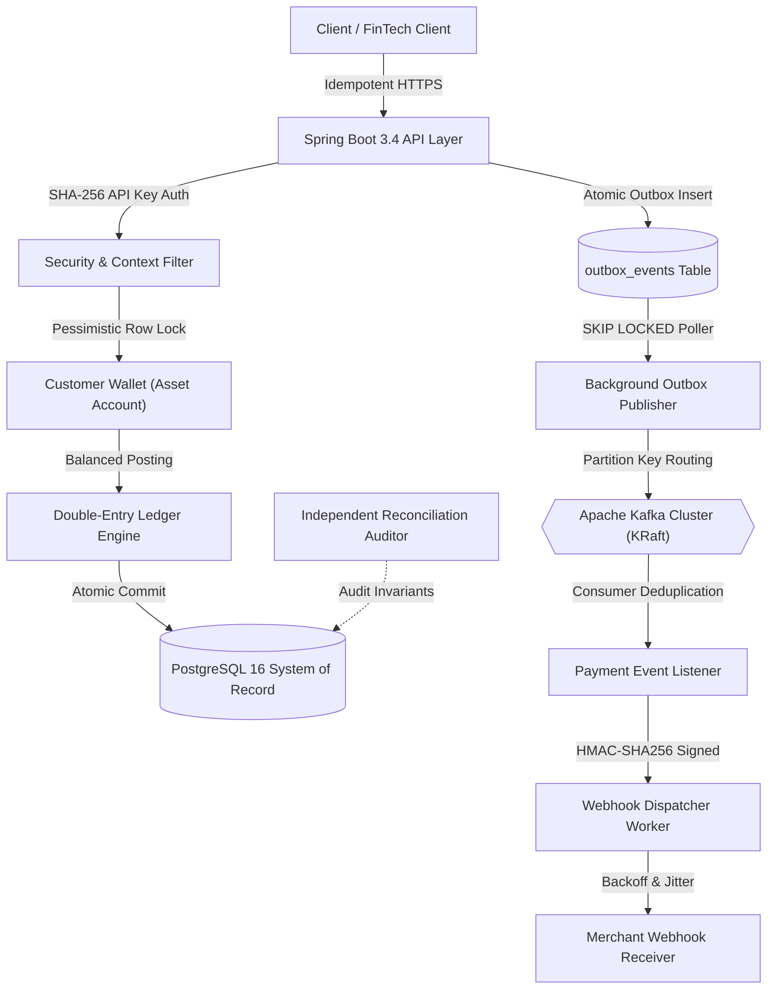

# LedgerFlow — Distributed Payment Engine

[](https://openjdk.org/)
[](https://spring.io/projects/spring-boot)
[](https://www.postgresql.org/)
[](https://kafka.apache.org/)
[](https://react.dev/)
[-3fb950?style=for-the-badge&logo=githubactions&logoColor=white)](docs/TESTING.md)

**LedgerFlow** is a production-inspired, distributed payment-processing and double-entry accounting engine built with Java, Spring Boot, PostgreSQL, and Apache Kafka. Designed around zero-loss financial guarantees, strict concurrency serialization, transactional outbox publishing, cryptographic idempotency, and automated reconciliation.

---

## Architecture Overview



---

## Core Engineering Capabilities

1. **Immutable Double-Entry Ledger:** Zero floating-point arithmetic. All balances represent integer minor units (`BIGINT`). Every fund movement creates balanced journal entries enforcing $\sum \text{Debits} == \sum \text{Credits}$.
2. **Pessimistic Concurrency Serialization:** Customer wallet deductions execute under `SELECT ... FOR UPDATE` row-level locks, mathematically eliminating race condition double-spending under concurrent traffic.
3. **Cryptographic Idempotency Engine:** Requests are SHA-256 fingerprinted and atomically reserved via `Idempotency-Key` headers. Duplicate requests return identical cached responses without duplicate ledger postings.
4. **Dual-Write Protection (Transactional Outbox):** Domain events (`payment.captured`, `payment.refunded`, etc.) stage into PostgreSQL within the business transaction. An asynchronous poller with `FOR UPDATE SKIP LOCKED` drains events to Kafka.
5. **Signed Webhooks & Redelivery:** Webhook payloads are signed using timestamped HMAC-SHA256 headers (`t=...,v1=...`) with constant-time verification, exponential backoff, and manual one-click redelivery.
6. **Independent Reconciliation Auditor:** Background auditor scans ledger journals, verifies wallet balances against historical ledger postings, validates refund capacity, and flags accounting anomalies.
7. **High-Density Operational Dashboard:** Built-in React 19 + TypeScript + Vite operations UI bundled directly into Spring Boot static resources, featuring an interactive sandbox simulator.

---

## Concurrency & Performance Benchmarks

Measured on a consumer workstation using [`BenchmarkLoadHarnessTest.java`](docs/PERFORMANCE.md) under intense single-wallet lock contention:

| Concurrent Threads | Total Requests | Captured | Declined (Safety) | Throughput | p50 Latency | p95 Latency | Invariant Violations |
| :---: | :---: | :---: | :---: | :---: | :---: | :---: | :---: |
| **10** | 10 | 5 | 5 | **53.12 req/s** | 147.56 ms | 186.16 ms | **0 (Zero)** |
| **50** | 50 | 20 | 30 | **121.41 req/s** | 260.84 ms | 392.22 ms | **0 (Zero)** |
| **100** | 100 | 40 | 60 | **173.21 req/s** | 391.28 ms | 546.69 ms | **0 (Zero)** |

*Zero negative balances or overdrafts occurred across all benchmark runs. See [docs/PERFORMANCE.md](docs/PERFORMANCE.md) for full metrics.*

---

## Quickstart Guide

### 1. Start Infrastructure (PostgreSQL, Kafka, Redis)
```powershell
docker compose --profile events up -d
```
*Maps isolated PostgreSQL to port `5433`, Kafka to `9092`, and Redis to `6379`.*

### 2. Run the Spring Boot Engine
```powershell
mvn spring-boot:run
```
*Flyway migrations execute automatically on startup. The operational dashboard is served at `http://localhost:8080/`.*

### 3. Run the Automated 15-Step Showcase
```powershell
powershell -ExecutionPolicy Bypass -File scripts/run-demo.ps1
```

---

## Interactive Portals & Endpoints

- **Operational Dashboard:** [http://localhost:8080/](http://localhost:8080/)
- **Swagger UI & OpenAPI:** [http://localhost:8080/swagger-ui.html](http://localhost:8080/swagger-ui.html)
- **Prometheus Metrics:** [http://localhost:8080/actuator/prometheus](http://localhost:8080/actuator/prometheus)
- **Health Check:** [http://localhost:8080/actuator/health](http://localhost:8080/actuator/health)

---

## Documentation Index

- [System Architecture & Module Boundaries](docs/ARCHITECTURE.md)
- [Relational Database Schema & Migrations](docs/DATABASE_DESIGN.md)
- [REST API Specifications & Error Protocols](docs/API_DESIGN.md)
- [Performance Benchmarks & Concurrency Stress](docs/PERFORMANCE.md)
- [Testing Matrix & Invariant Verification](docs/TESTING.md)
- [Architectural Decision Records (ADR)](docs/DECISIONS.md)
- [Step-by-Step Implementation Plan](docs/IMPLEMENTATION_PLAN.md)

---

## License

This project is licensed under the [MIT License](LICENSE).
