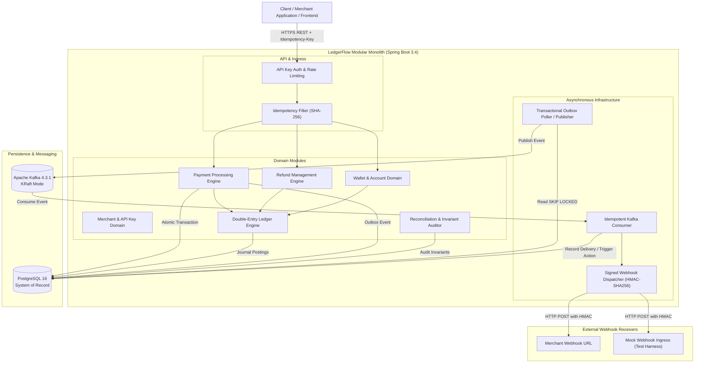
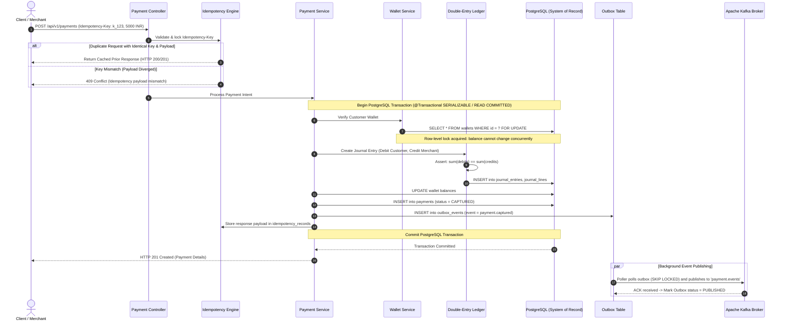
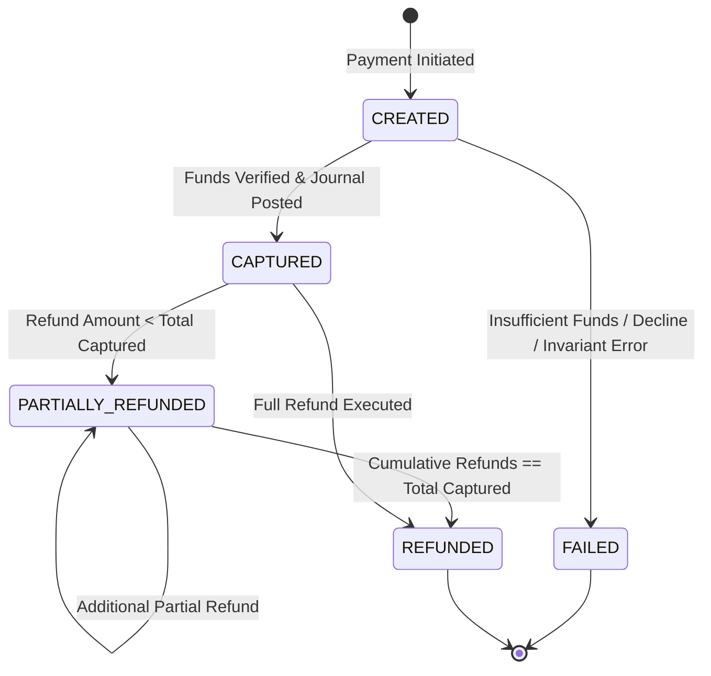

# LedgerFlow — System Architecture & Design

## 1. Executive Architecture Summary

LedgerFlow is designed as a **Modular Monolith with Asynchronous Event Workers**. It models the core architectural guarantees required of modern financial infrastructure:
- **Absolute Financial Correctness**: Double-entry ledger with immutable journals, minor currency units, and zero floating-point arithmetic.
- **Double-Spend Prevention**: Pessimistic row-level locking (`SELECT ... FOR UPDATE`) in PostgreSQL with strictly ordered lock acquisitions to eliminate deadlocks.
- **Strict Idempotency**: Atomic reservation of idempotency keys with SHA-256 payload fingerprinting and deterministic cached replay.
- **Transactional Outbox**: Guaranteed atomic persistence of business state and outbox events in a single PostgreSQL transaction, published asynchronously to Apache Kafka.
- **Event Deduplication**: Consumer-side idempotency guaranteeing that at-least-once delivery produces exactly-once financial effects.

---

## 2. High-Level Component Architecture



---

## 3. Package & Module Boundaries

The backend application is structured by business capability rather than technical layering:

```
com.ledgerflow.engine
├── common
│   ├── config          # Jackson, Async, Security, OpenAPI
│   ├── error           # RFC 7807 ProblemDetail exceptions & handler
│   ├── logging         # MDC Correlation ID filters and structured formatters
│   └── money           # CurrencyCode, MinorUnitMoney, Exponent rules
├── merchant
│   ├── domain          # Merchant, ApiKey entities
│   ├── repository      # Spring Data Repositories
│   └── service         # Merchant onboarding, key hashing & validation
├── wallet
│   ├── domain          # Wallet, BalanceSnapshot entities
│   ├── repository      # Wallet repository
│   └── service         # Wallet creation, balance inquiries, funding
├── ledger
│   ├── domain          # Account, JournalEntry, JournalLine, AccountType
│   ├── repository      # Ledger repositories
│   └── service         # Postings engine, sum(debits)==sum(credits) invariant
├── payment
│   ├── domain          # Payment, PaymentStatus, IdempotencyRecord
│   ├── repository      # Payment & Idempotency repositories
│   └── service         # Payment state machine, capture, concurrency locks
├── refund
│   ├── domain          # Refund, RefundStatus
│   ├── repository      # Refund repository
│   └── service         # Full/partial refunds, cumulative limit validation
├── outbox
│   ├── domain          # OutboxEvent, OutboxStatus
│   ├── repository      # Outbox repository (SELECT FOR UPDATE SKIP LOCKED)
│   └── service         # Transactional event persistence and Kafka publisher
├── event
│   ├── model           # Canonical domain event schemas (v1)
│   └── consumer        # Idempotent Kafka consumer listeners
├── webhook
│   ├── domain          # WebhookSubscription, WebhookDeliveryAttempt
│   ├── repository      # Webhook repositories
│   └── service         # HMAC-SHA256 signing, exponential backoff dispatcher
└── reconciliation
    ├── domain          # ReconciliationRun, ReconciliationDiscrepancy
    ├── repository      # Reconciliation repositories
    └── service         # Independent ledger & wallet balance auditor
```

---

## 4. End-to-End Payment Flow & Invariant Enforcement



---

## 5. Payment State Machine



---

## 6. Double-Entry Accounting Model

Every financial movement involves at least two balanced postings:

| Transaction Type | Debit Account (DR) | Credit Account (CR) | Invariant |
|---|---|---|---|
| **Sandbox Funding** | `ASSET:CUSTOMER_WALLET` | `EQUITY:SANDBOX_CLEARING` | DR = CR |
| **Payment Capture** | `LIABILITY:MERCHANT_PAYABLE` | `ASSET:CUSTOMER_WALLET` | DR = CR |
| **Refund Reversal** | `ASSET:CUSTOMER_WALLET` | `LIABILITY:MERCHANT_PAYABLE` | DR = CR |
| **Platform Fee (if configured)** | `REVENUE:PLATFORM_FEES` | `ASSET:CUSTOMER_WALLET` | DR = CR |

**Zero Floating Point Guarantee**: All amounts are recorded as `BIGINT` minor units (e.g., `10000` for `₹100.00` or `$100.00` where exponent is 2). Supported initial currencies: `INR` (Indian Rupee), `USD` (US Dollar), `EUR` (Euro), `GBP` (British Pound).

---

## 7. Fault Tolerance & Failure Recovery

1. **Kafka Broker Outage**:
   - The payment processing transaction commits to PostgreSQL regardless of Kafka broker availability.
   - Events reside durably in `outbox_events` with status `PENDING`.
   - Once Kafka recovers, the background poller drains the pending events with zero loss.
2. **Publisher Crash Post-Kafka ACK**:
   - If the outbox worker publishes an event to Kafka but crashes before updating the PostgreSQL outbox row, the event will be re-sent upon worker restart.
   - **Mitigation**: Kafka consumers use the event's unique `event_id` and consumer deduplication table (`consumed_events`) with an atomic `INSERT ON CONFLICT DO NOTHING` check to discard duplicates.
3. **Concurrent Competing Payments**:
   - When 10 threads attempt to drain a customer's ₹100 balance simultaneously:
   - Row-level lock `SELECT ... FOR UPDATE` serializes the balance check and journal posting.
   - The first transaction succeeds; subsequent transactions detect insufficient funds and gracefully fail without overdrafts.
