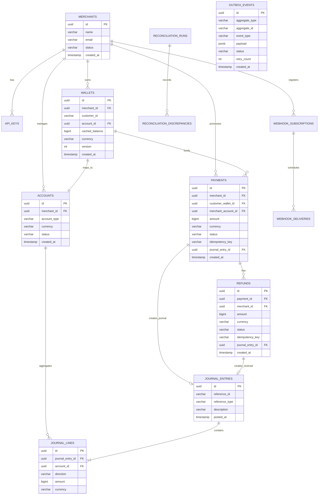

# LedgerFlow — Database Schema & Relational Design

## 1. Persistence Philosophy

PostgreSQL 16 serves as the **exclusive and authoritative system of record**. No financial state or balance exists solely in an in-memory cache, message queue, or external system.

Key persistence principles:
1. **Integer Minor Units**: Money values (`amount`) are always stored as `BIGINT` representing minor currency units (e.g. 10000 = ₹100.00 / $100.00). Floating-point data types (`FLOAT`, `REAL`, `DOUBLE PRECISION`) are strictly forbidden.
2. **Positive-Only Postings**: Every journal line specifies a direction (`DEBIT` or `CREDIT`) with a strictly positive amount (`amount > 0`).
3. **Double-Entry Enforcement**: A database transaction posting to `journal_entries` must include paired rows in `journal_lines` such that `sum(DEBIT) == sum(CREDIT)`.
4. **Row-Level Concurrency Safety**: High-concurrency wallet updates use `SELECT ... FOR UPDATE` ordered deterministically by primary key to guarantee serializability without deadlocks.

---

## 2. Entity-Relationship Diagram

---

## 3. Core Tables Specification

### 3.1 `merchants` & `api_keys`
- `merchants`: Central tenant entity.
- `api_keys`: Hashed API secrets.
  - `key_hash`: SHA-256 hex string of the secret token.
  - `key_prefix`: First 8 chars for identification (e.g. `lf_live_...`).
  - Plaintext tokens are never persisted.

### 3.2 `accounts`, `wallets` & `ledger`
- `accounts`: Represents financial ledger accounts.
  - `account_type`: `ASSET` (e.g. Customer Wallets), `LIABILITY` (e.g. Merchant Payable), `EQUITY` (e.g. Sandbox Clearing Source), `REVENUE` (e.g. Fees).
  - `currency`: ISO 4217 code (`INR`, `USD`, `EUR`, `GBP`).
- `wallets`: Customer-facing wallet mapping to an `ASSET` account.
  - `cached_balance`: Optimized snapshot updated in lockstep with ledger postings.
  - `version`: Optimistic locking field for non-locking queries.
- `journal_entries`: Immutable header for an accounting event.
  - `reference_id`: ID of the payment, refund, or funding transaction.
  - `reference_type`: `PAYMENT`, `REFUND`, `SANDBOX_FUNDING`.
- `journal_lines`: Debits and credits.
  - `direction`: `DEBIT` or `CREDIT`.
  - `amount`: `BIGINT CHECK (amount > 0)`.

### 3.3 `payments` & `refunds`
- `payments`: Lifecycle tracking of a charge request.
  - `status`: `CREATED`, `CAPTURED`, `FAILED`, `PARTIALLY_REFUNDED`, `REFUNDED`.
  - `amount`: Total amount in minor units.
  - `idempotency_key`: Unique per merchant.
- `refunds`: Reversals against captured payments.
  - `amount`: Refund chunk amount (`sum(refunds.amount) <= payment.amount`).

### 3.4 `idempotency_records`
- `idempotency_key`: Client supplied key (`VARCHAR(128)`).
- `merchant_id`: Tenant scope.
- `request_hash`: SHA-256 of request method + URI + canonicalized body.
- `status`: `PENDING`, `COMPLETED`, `FAILED`.
- `response_code`: HTTP status code to replay.
- `response_body`: JSON response payload to replay.
- `created_at`: Expiration TTL reference (default 24 hours).

### 3.5 `outbox_events` & `consumed_events`
- `outbox_events`:
  - `status`: `PENDING`, `PUBLISHED`, `FAILED`.
  - `payload`: JSONB event representation.
  - Query Index: `CREATE INDEX idx_outbox_pending ON outbox_events (status, created_at) WHERE status = 'PENDING';`
- `consumed_events`:
  - `event_id`: UUID of consumed message.
  - `consumer_group`: Kafka group identifier.
  - `processed_at`: Ingestion timestamp.
  - Primary Key: `(event_id, consumer_group)`.

### 3.6 `webhooks` & `reconciliation`
- `webhook_subscriptions`: Merchant webhook URLs and HMAC secrets.
- `webhook_deliveries`: Full attempt logs with HTTP status, response body snapshot, retry timestamp.
- `reconciliation_runs`: Audit runs with timestamp and discrepancy counts.
- `reconciliation_discrepancies`: Specific detected mismatches with JSON debug payload.
